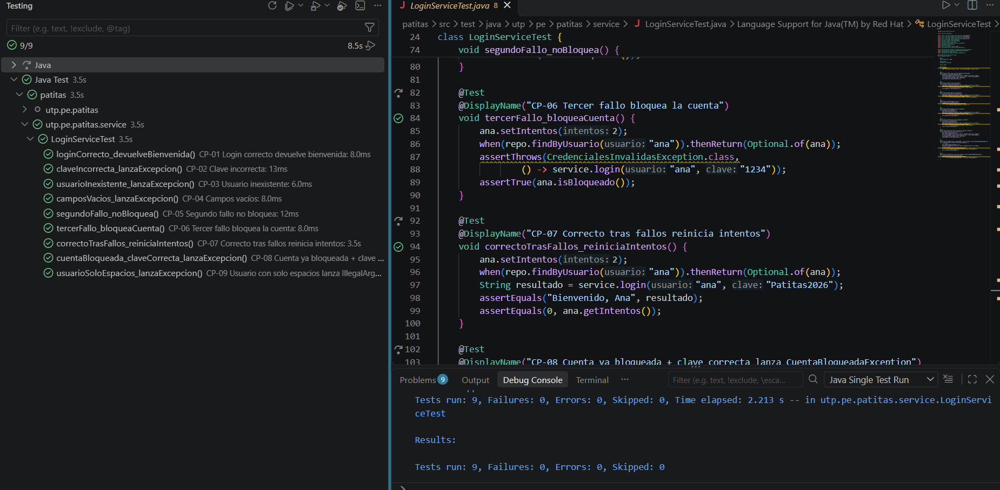
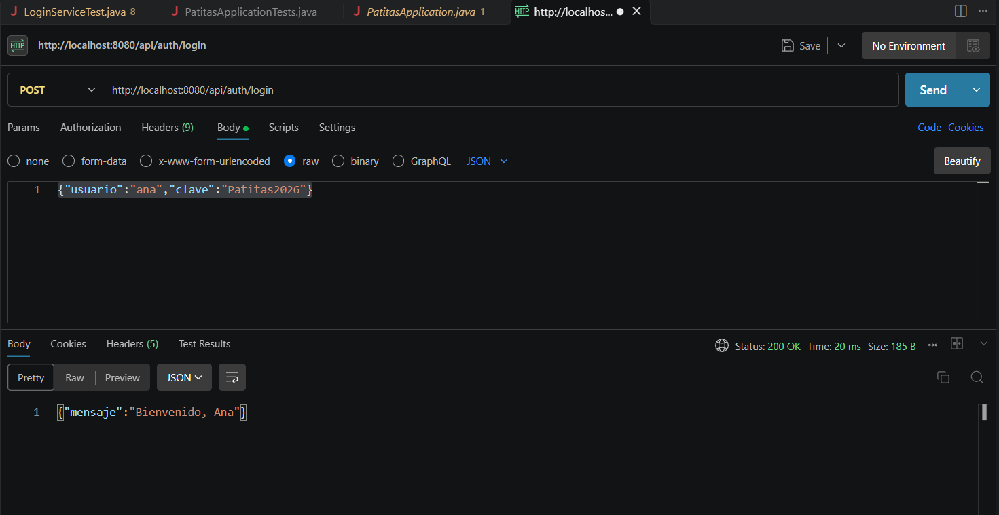
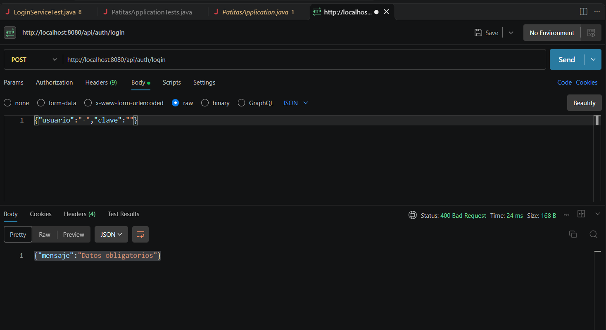
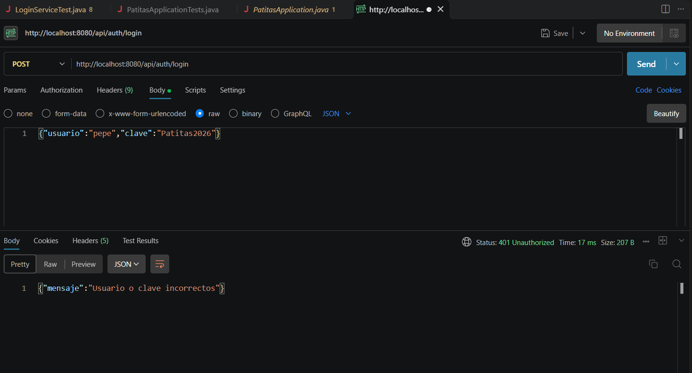
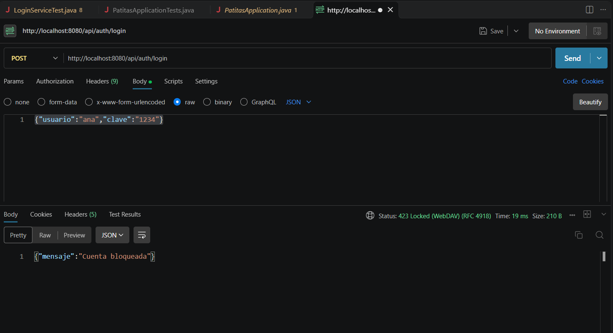
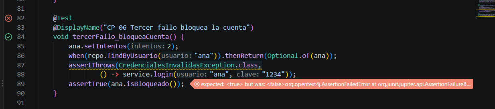

# 🐾 Patitas · Laboratorio de pruebas de software

**Curso:** Curso integrador I: sistemas - software · **Semana 13 · Sesión 26 · Unidad 4**

Pruebas unitarias (JUnit 5 + Mockito) y pruebas de sistema (Postman) para el módulo de **login de la Veterinaria Patitas**, desarrollado con Spring Boot, Maven y Visual Studio Code.

|                            |                                                                                    |
| -------------------------- | ---------------------------------------------------------------------------------- |
| **Paquete base**     | `utp.pe.patitas`                                                                 |
| **Endpoint probado** | `POST http://localhost:8080/api/auth/login`                                      |
| **Base de datos**    | H2 en memoria (usuario de prueba: `ana / Patitas2026`)                           |
| **Resultado**        | 9 pruebas unitarias en verde y 4 respuestas HTTP verificadas (200, 400, 401 y 423) |

---

## 1. Evidencias

### 1.1 Pruebas unitarias: panel Testing con 9/9 en verde



### 1.2 Pruebas de sistema con Postman

| Caso                     | Body enviado                            | Respuesta esperada                                          |
| ------------------------ | --------------------------------------- | ----------------------------------------------------------- |
| Login correcto           | `ana / Patitas2026`                   | **200 OK** · "Bienvenido, Ana"                       |
| Campos vacíos           | `"" / ""`                             | **400 Bad Request** · "Datos obligatorios"           |
| Credenciales incorrectas | `ana / 1234` o `pepe / Patitas2026` | **401 Unauthorized** · "Usuario o clave incorrectos" |
| Cuenta bloqueada         | 4.º envío de `ana / 1234`           | **423 Locked** · "Cuenta bloqueada"                  |

**200 OK**



**400 Bad Request**



**401 Unauthorized**



**423 Locked** (cuarto intento seguido con clave incorrecta)



---

## 2. Casos de prueba

| Caso  | Tipo     | Descripción                           | Resultado esperado                                |
| ----- | -------- | -------------------------------------- | ------------------------------------------------- |
| CP-01 | Unitaria | Login correcto                         | "Bienvenido, Ana" e intentos = 0                  |
| CP-02 | Unitaria | Clave incorrecta                       | `CredencialesInvalidasException` e intentos = 1 |
| CP-03 | Unitaria | Usuario inexistente                    | `CredencialesInvalidasException`                |
| CP-04 | Unitaria | Campos vacíos                         | `IllegalArgumentException`                      |
| CP-05 | Unitaria | Segundo fallo                          | No bloquea la cuenta                              |
| CP-06 | Unitaria | Tercer fallo                           | Bloquea la cuenta                                 |
| CP-07 | Unitaria | Clave correcta tras 2 fallos           | intentos = 0                                      |
| CP-08 | Unitaria | Cuenta ya bloqueada con clave correcta | `CuentaBloqueadaException`                      |
| CP-09 | Unitaria | Usuario con solo espacios              | `IllegalArgumentException`                      |
| CP-10 | Sistema  | 4 envíos seguidos de `ana / 1234`   | 401, 401, 401 y **423** "Cuenta bloqueada"  |

Las pruebas están en `src/test/java/utp/pe/patitas/service/LoginServiceTest.java`. Cada una sigue el patrón *Arrange – Act – Assert* y usa `@DisplayName` con su código de caso.

---

## 3. Defecto encontrado y corregido

**Síntoma:** CP-06 salió en rojo con `expected: <true> but was: <false>`.



**Causa:** en `LoginService`, la condición `if (u.getIntentos() > 3)` bloqueaba la cuenta en el **cuarto** fallo, cuando la regla pide bloquearla en el **tercero**.

**Corrección:** se cambió a `if (u.getIntentos() >= 3)`. Después se volvieron a ejecutar las pruebas desde el panel Testing y con `.\mvnw test` (prueba de regresión), y todas pasaron.

**Defecto de capa:** antes de crear `ManejadorErrores`, un dato inválido en Postman devolvía **500**. Con el manejador, cada excepción se traduce a su código HTTP:

| Excepción                         | Código HTTP     |
| ---------------------------------- | ---------------- |
| `IllegalArgumentException`       | 400 Bad Request  |
| `CredencialesInvalidasException` | 401 Unauthorized |
| `CuentaBloqueadaException`       | 423 Locked       |

---

## 4. Cómo ejecutar el proyecto

```powershell
.\mvnw test               # ejecuta las pruebas unitarias
.\mvnw spring-boot:run    # levanta la API en el puerto 8080
```

Los intentos fallidos se acumulan mientras la aplicación está en ejecución. Para repetir la prueba del bloqueo, reinicia la app antes de enviar los 4 intentos.

---

## 5. Metacognición

**¿Qué aprendí?**
`@Mock` crea un repositorio falso para probar sin base de datos; `@InjectMocks` crea el `LoginService` y le inyecta ese repositorio falso; `assertThrows` comprueba que el login lance la excepción esperada, por ejemplo `CredencialesInvalidasException` cuando la clave es incorrecta.

**¿Cómo lo aprendí?**
Me trabé con el nombre del paquete (`utp.pe.patitas` en lugar de `pe.patitas`) y con una respuesta de Postman cuyo estado y mensaje no coincidían. Lo resolví corrigiendo los `package` e `import` de cada clase y reiniciando la aplicación para repetir las pruebas desde cero.

**¿Para qué me sirve?**
En mi proyecto probaré primero el método de login con el caso límite de un usuario con solo espacios, que debe lanzar `IllegalArgumentException`.
